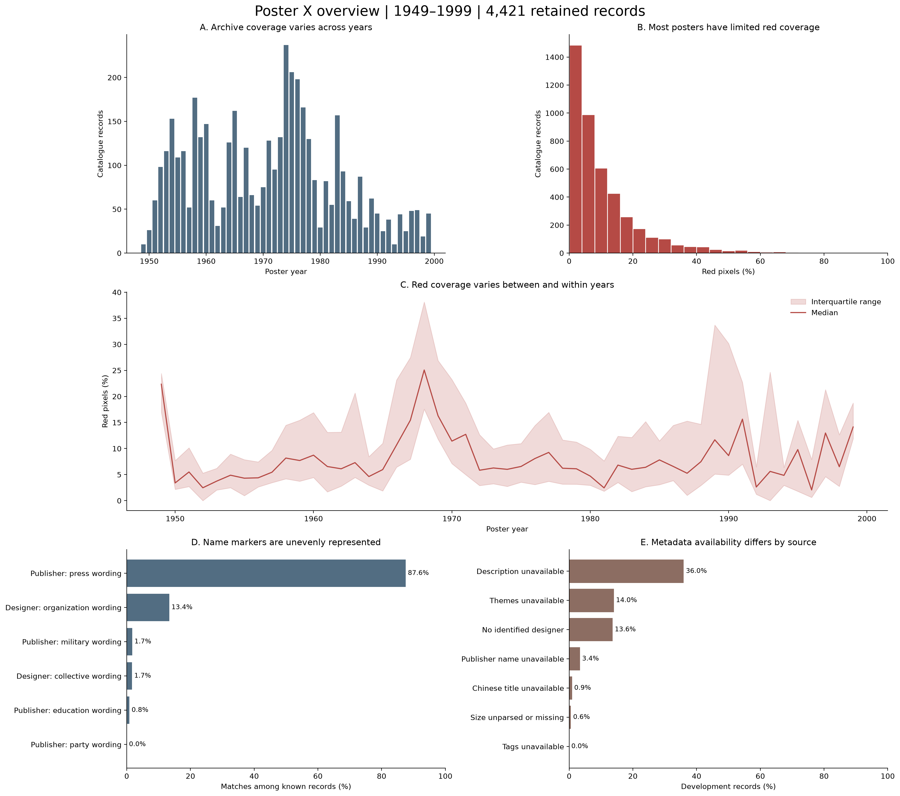

# Posters
DATA 1030 Term Project

## Preprocessing and training handoff

Read [the technical handoff](docs/PREPROCESSING_HANDOFF.md) before training.
The validated annual input is `data/processed/training_handoff/development.csv`.
Poster features in year t predict active parent MID counts in year t+1.
The fixed chronological split has 51 development years, one embargo year and 13 test years.



To regenerate the joined tables, checks and selected overview from saved processed data:

```bash
python src/build_training_handoff.py
```

Use `environment-preprocessing.yml` for preprocessing dependencies. Upstream notebook source snapshots are in `src/notebooks/`. Raw image downloads remain local; saved metadata and processed tables are shared. No models have been trained in this handoff.
