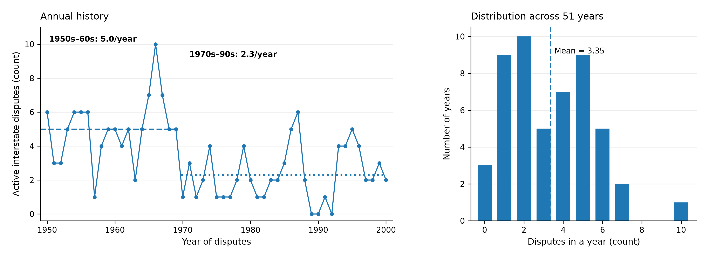
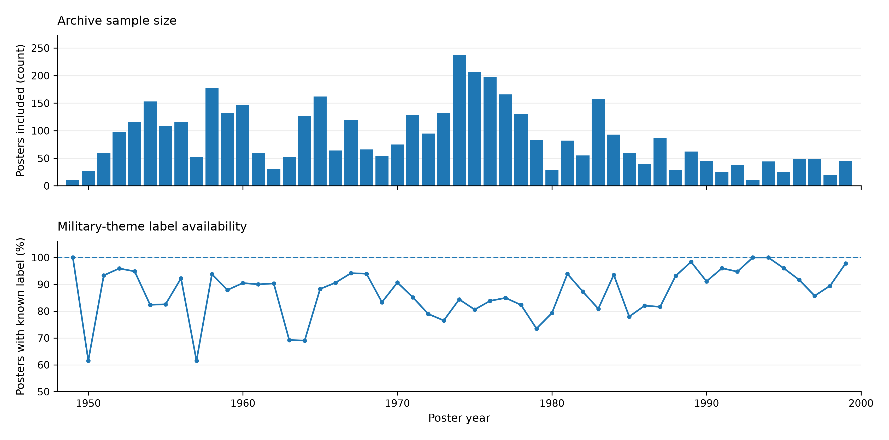
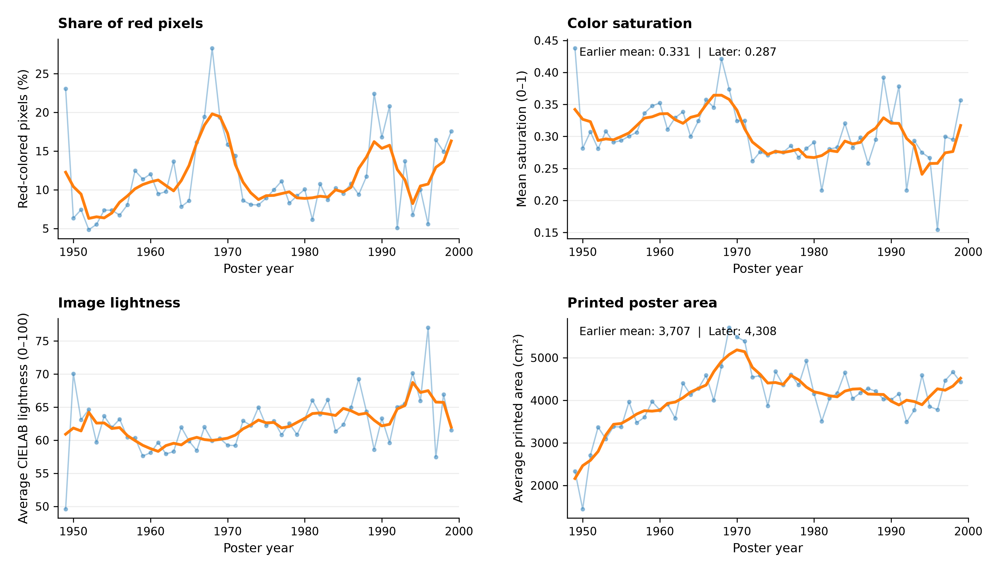
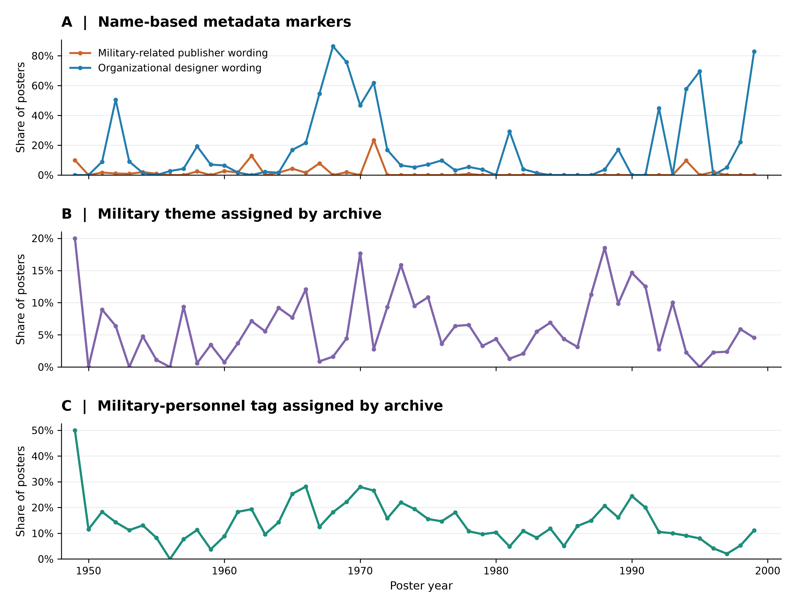

# Preprocessing Notebooks

The project uses poster features in year t to predict the number of active militarized interstate disputes involving China in year t+1.

| Notebook | Main tasks | Main outputs |
| --- | --- | --- |
| `poster_data.ipynb` | Crawls ChinesePosters.net for images and metadata. Includes pilot and full collection, checkpoints, error logging, image validation, and missing-field checks. | Raw poster metadata, images, and audit files under `data/raw/posters_learning/`. |
| `military_data.ipynb` | Reads Dyadic MID 4.03, selects China for 1950-2014, checks duplicates, and counts distinct parent disputes per year. Explores alternative outcomes before saving the final count target. | `data/processed/military/annual_military_target.csv` and target documentation. |
| `poster_preprocessing.ipynb` | Parses dates; retains eligible posters; extracts color, physical-size, title, designer, publisher, and archive features; checks exact image duplicates; aggregates features annually; and generates X visualizations. | `data/processed/poster_x_features_v1.csv`, `annual_x_features_v1.csv`, feature-set definitions, and figures. |

## Running order

1. Run `poster_data.ipynb`, or use the existing saved collection.
2. Run `military_data.ipynb` to prepare Y.
3. Run `poster_preprocessing.ipynb` to prepare X. Its target-matching cells require the military target.
4. Run `python src/build_training_handoff.py` to rebuild and validate the final annual X/Y tables and selected overview figure.

Run from the repository root. Shared notebook snapshots are in `src/notebooks/`. Image extraction requires the downloaded images.

## Training data

The complete joined table is `data/processed/training_handoff/annual_model_table.csv`. Separate development, embargo, and test CSVs contain 51, 1, and 13 annual observations, respectively.

Missing X values are retained; imputation and scaling must be fitted within training folds. Preprocessing outputs include more candidate columns than the final selected feature set. Archive annotations are retrospective and should be evaluated separately.

`Diplomacy_data.ipynb` is earlier exploratory work and is not used in the current task.

# EDA Notebook

## Exploratory Data Analysis (EDA)

### Overview

Exploratory data analysis was conducted on the development dataset, comprising 51 annual observations from 1949 to 1999. Each observation contains aggregated characteristics of Chinese propaganda posters from year \(t\), paired with the number of active militarized interstate disputes (MIDs) involving China in year \(t+1\).

The held-out test set was excluded from all exploratory analyses and feature-selection decisions.

### Feature Selection

We initially considered 25 candidate predictors, including visual characteristics, textual and organizational metadata, and two military-related archive indicators.

To reduce redundancy and improve interpretability, we examined feature distributions, sparsity, and pairwise Pearson correlations. We proposed a reduced set of 12 features:

| Category | Selected Features |
|---|---|
| Color | Red-pixel share, color saturation |
| Lightness | Mean lightness, lightness variation |
| Physical dimensions | Poster area, aspect ratio |
| Metadata | Chinese title length, designer identification, organizational designer wording, military-related publisher wording |
| Archive annotations | Military theme, military-personnel tag |

The maximum absolute pairwise correlation decreased from approximately 0.981 among the original candidates to 0.801 among the selected features.

The reduced feature set is exploratory rather than statistically optimal and will be evaluated through chronological cross-validation.

**Note:** Archive theme and personnel tags were assigned retrospectively and may not have been available at the historical prediction date.

### EDA Visualizations

#### 1. Historical MID Distribution

Annual MID counts range from 0 to 10, with an average of approximately 3.35. Dispute counts were generally higher during the 1950s and 1960s than in subsequent decades.

#### 2. Poster Availability and Annotation Coverage

The number of eligible posters varies substantially across years, ranging from 10 to 237. Differences in archival coverage may affect the reliability of annual feature aggregates.

#### 3. Visual Characteristics Over Time

The figure examines historical changes in red-pixel share, color saturation, image lightness, and printed poster area.

#### 4. Military and Organizational Indicators

Four indicators are examined: military-related publisher wording, organizational designer wording, archive military-theme labels, and military-personnel tags.

These indicators exhibit temporal variation, but their predictive usefulness remains to be evaluated.

### Additional Figures

- [Correlation matrix of selected features](../figures/training_eda/A1_selected_feature_correlations.png)
- [Feature redundancy comparison](../figures/training_eda/04_feature_redundancy.png)

### Code and Reproducibility

The EDA notebook is available at:

[`src/notebooks/training_eda.ipynb`](src/notebooks/training_eda.ipynb)

The analysis uses:

`data/processed/training_handoff/development.csv`

All figures were generated using Python, pandas, NumPy, and Matplotlib.

EDA was restricted to the development data. Scaling, supervised feature selection, and hyperparameter tuning will be performed within chronological training folds during model development.